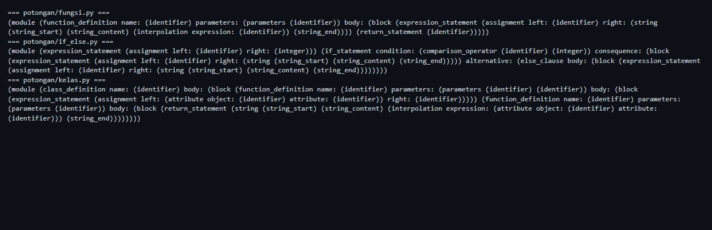
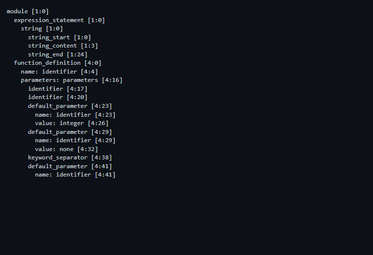
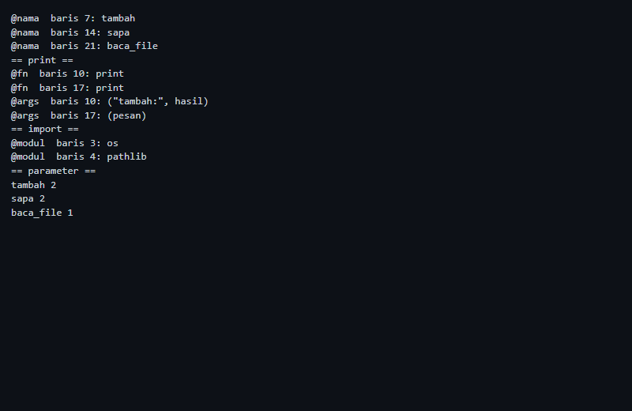
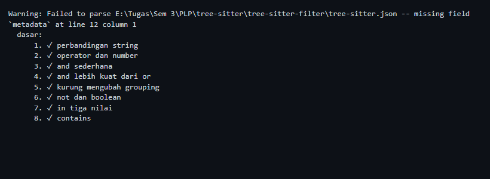
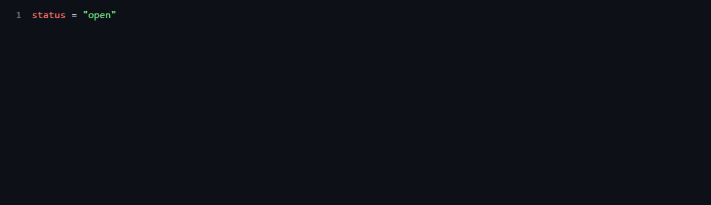

# Laporan Tugas Tree-sitter

## 1. Identitas dan ringkasan

- Nama / NIM: Adhiya / _(isi NIM)_
- Ringkasan: praktikum membaca dan memanipulasi pohon sintaks memakai Tree-sitter pada Python, membangun grammar DSL filter (`tree-sitter-filter`), sistem highlight, dan mini proyek `cek.py` untuk memindai TODO, fungsi panjang, serta error sintaks.
- Lingkungan: Windows 11, Python 3.14.5, tree-sitter CLI 0.24.7, Python binding 0.25.2 (rincian di `docs/environment.md`).

## 2. Tugas 1 dan 2 — pohon, perbandingan, dan penjelajah

Pohon hasil parse tiga potongan kode (`fungsi.py`, `if_else.py`, `kelas.py`) disimpan di `tugas1-3/output-t1.txt`. Perkiraan sebelum parse ada di `tugas1-3/pohon-perkiraan.md`; perbandingannya menunjukkan node anonim seperti `def`, `:`, `=` tidak muncul di S-expression, melainkan menjadi node bernama seperti `function_definition`, `identifier`, `block`.

Uji node anonim dan ERROR/MISSING ada di `tugas1-3/output-anonim.txt` dan `tugas1-3/output-rusak.txt`. Penjelajah rekursif (`tugas1-3/jelajah.py`) dan versi TreeCursor (`tugas1-3/jelajah_cursor.py`) menghasilkan 100 baris traversal pada `contoh100.py`; keduanya memakai field (`name:`, `parameters:`, `body:`) agar hubungan antarnode jelas.

## 3. Tugas 3 — query dan hitungan manual

Lima query wajib tersimpan sebagai `semua.scm`, `nama_fungsi.scm`, `parameter.scm`, `print.scm`, `import.scm`; penjalan query ada di `q.py` dan `q_param.py`. Hitungan manual sebelum query ada di `tugas1-3/hitungan-manual.md`: 3 fungsi, 5 parameter, 2 panggilan `print`, 2 import — semuanya cocok dengan hasil query.

Catatan penting: `output-print.txt` memuat 4 baris karena setiap panggilan menghasilkan dua capture (`@fn` dan `@args`); yang dihitung sebagai jumlah panggilan adalah jumlah match, bukan jumlah baris. Selain itu, `default_parameter` dihitung sebagai satu parameter dan `from pathlib import Path` sebagai satu import.

## 4. Tugas 4 — grammar DSL filter

Grammar dibangun bertahap: perbandingan → operator + number → `and` → `or` (dengan conflict sengaja di T4-5, lalu `prec.left` di T4-6) → kurung → `not` + boolean → field → `in` → `contains`. Bukti conflict ada di `tree-sitter-filter/output-conflict.txt` dan `output-conflict-tanpa-prec.txt`.

Prioritas terbukti dari parse `a = 1 or b = 2 and c = 3`: `and` masuk ke `right:` dari `or_expression`. Delapan tes corpus di `test/corpus/dasar.txt` mencakup string, number, prioritas, kurung, `not`+boolean, `in`, dan `contains`.

Generator `sql_where.py` mengubah pohon menjadi klausa `WHERE` ber-parameter (placeholder `?` dan daftar `PARAMS` terpisah); keluarannya ada di `tree-sitter-filter/output-sql.txt`.

## 5. Tugas 5 — highlight

`tree-sitter init-config` dipakai untuk menambah `parser-directories`; `tree-sitter.json` dilengkapi `metadata.version` agar grammar ditemukan dari folder lain. Query `queries/highlights.scm` mewarnai keyword, operator, string, number, boolean, dan field. Verifikasi 22 capture dilakukan pada input yang memuat semua jenis token.

## 6. Tugas 6 — mini proyek `cek.py`

`cek/cek.py` memindai tiga hal: komentar TODO/FIXME (regex batas kata), fungsi lebih dari 30 baris, dan file dengan error sintaks. Hasil pada folder uji ada di `cek/output-uji.txt`; hasil pada repo nyata (`itsdangerous`, 15 file `.py`) ada di `cek/output-repo.txt` dengan 7 temuan. Verifikasi manual dua file memakai `grep`, modul `ast`, dan `py_compile` tercatat di `cek/verifikasi-manual.md` — seluruhnya cocok. Fitur pengayaan JavaScript ada di `cek/cek_js.py`.
